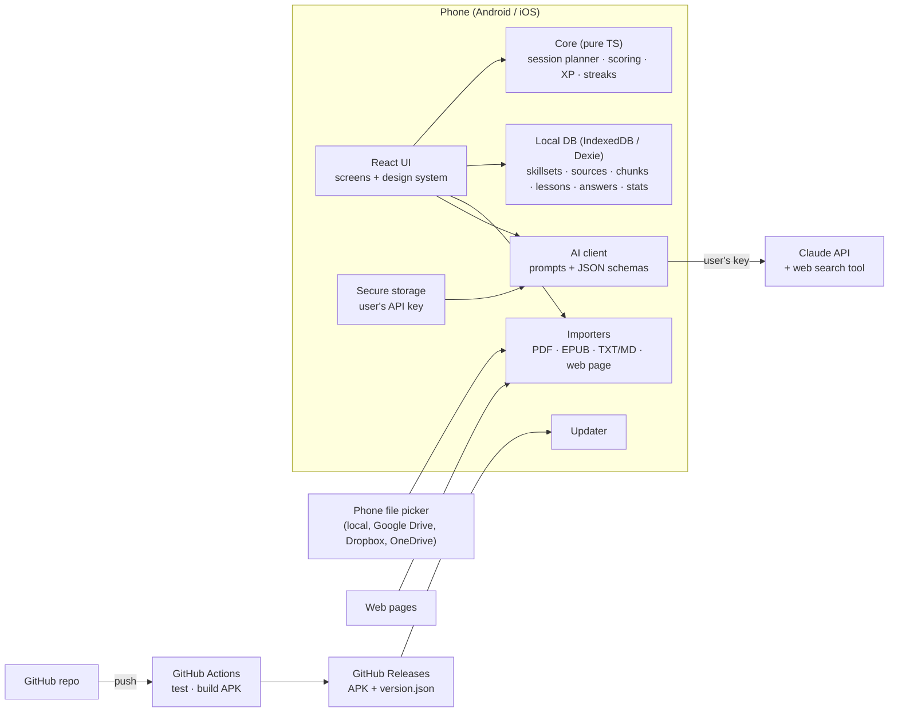

# PES Mobile App — Architecture

**Status:** decided 2026-10-23 — option A (see ADRs)

## 0. "Should it be a web app to avoid version problems?"
**Mostly yes.** Writing the app once in web technology (HTML5 + TypeScript) gives one codebase for Android, iOS and the browser, and lets the app update without waiting for store review. A pure web app alone falls short on three of your requirements, though: no APK or store listing, weak reminders on iPhone, and no secure place for the API key. The usual answer is a **web core inside a thin native shell** (Capacitor): the same web code ships as an APK/iOS app, gets native file access, notifications and secure storage, and can still pull updates from GitHub.

## 1. Options

| | **A. Web core + Capacitor shell** *(recommended)* | **B. Pure web app (PWA)** | **C. Expo / React Native** |
|---|---|---|---|
| What it is | React + TypeScript web app, packaged as Android/iOS apps by Capacitor; also runs in a browser | Same web app, installed from the browser ("Add to home screen") | Native UI written in React Native |
| APK / stores | Yes / Yes | No APK; Play only via a wrapper later; App Store no | Yes / Yes |
| Updates from GitHub | Yes: CI builds the APK into GitHub Releases, app offers the update; later live web-layer updates | Instant: every push to GitHub Pages | Via Expo's update service, not GitHub |
| Files incl. Google Drive / Dropbox | Phone's file picker | Browser file picker | Phone's file picker |
| Reminders on iPhone | Native local notifications | Limited | Native |
| Secure key storage | Keychain / Keystore | Browser storage only | Keychain / Keystore |
| Fit for you as co-developer | HTML/CSS/TS, close to the current hub | Same | React Native specifics, more native tooling |
| Cost for MVP | $0 (GitHub Actions free for public repos) | $0 | $0 with Expo free tier and queues |

### Decision matrix (1–5, weighted)

| Criterion | Weight | A | B | C |
|---|---|---|---|---|
| Updates straight from GitHub | 3 | 4 | 5 | 2 |
| APK now, stores later | 3 | 5 | 1 | 5 |
| Time to MVP | 2 | 4 | 5 | 3 |
| Native features (files, reminders, secure key) | 2 | 4 | 2 | 5 |
| Easy for Oleg + Claude to maintain | 2 | 5 | 5 | 3 |
| Native look and feel | 1 | 3 | 3 | 5 |
| **Weighted total** | | **56** | **45** | **48** |

**Recommendation: A.** It matches all nine points: APK now, store path later, updates from GitHub, one web codebase.

## 2. Recommended architecture (A) in detail



| Layer | Choice | Why |
|---|---|---|
| UI | React 19 + TypeScript + Vite | Mainstream, fast, easy to co-develop |
| Native shell | Capacitor 8 | Same web code → Android/iOS; plugins for files, notifications, secure storage |
| Styling | CSS variables (design tokens) + component CSS | Readable for you; light theme later = one token set |
| Local data | IndexedDB via Dexie; versioned schema; JSON export | Works offline and in the browser |
| Sources | Phone file picker; pdf.js for PDF; EPUB via JSZip; web pages via native HTTP | Covers local files and cloud drives without OAuth setup |
| Lesson engine | Sources → chunks (≈ pages/sections) → curriculum; each session takes the next chunk(s) sized to the minutes chosen | Large books never sent whole; lessons follow the source order |
| AI | Claude Messages API from the device with the user's key; JSON-only responses checked against schemas; web search tool when "use internet" is on; provider interface for others later | No server needed, cost on the user's key |
| Updates (dev) | Push → GitHub Actions builds signed APK → GitHub Release; app checks the latest release and offers install | "Updates directly from my GitHub" |
| Updates (public) | Play Store / App Store; optional live web-layer updates later | Store rules |
| Later (M3) | Supabase (free tier): accounts, leaderboard, sync | Only when needed |

### Build constraint
My workspace can't reach Google's Android build servers, so **APKs are built by GitHub Actions** (free for public repos). That needs the code on GitHub, either pushed by me (if you connect GitHub to Claude) or by you from your Mac.

### Repository
New **public** repo `pes-app` (the app has no secrets thanks to BYOK; a public repo lets the app check for updates without a token). Your existing `Personal-Education-System` repo stays private with your notes. Locally: `Personal Education System/pes-app/` (ignored by the parent repo).

```
pes-app/
  src/
    app/          routing, layout, providers
    screens/      Home, Skillsets, Skillset, Session, Stats, Rewards, Settings, Onboarding
    components/   design-system pieces (Card, Ring, ProgressBar, TabBar, Button…)
    core/         pure logic + tests (planner, scoring, xp, streak, levels, badges)
    ai/           provider client, prompts, response schemas
    data/         Dexie DB, repositories, export/import
    sources/      importers and chunking
    update/       GitHub release checker
  android/        Capacitor Android project
  .github/workflows/android.yml
  docs/           brief, architecture, changelog
  CLAUDE.md       working rules for Claude
```

## 3. Milestones
- **M1 — MVP on your Android phone:** everything in the brief's M1 scope + CI + self-update.
- **M2:** iOS build (your Mac/Xcode), daily reminders, light theme, flashcards with spaced repetition.
- **M3:** accounts, leaderboard, sync across devices (Supabase); direct cloud-folder sync.
- **M4:** store releases (Play, App Store), Russian UI, more AI providers.

## 4. ADRs

### ADR-001 — Web core in a Capacitor shell
- **Context:** one codebase for Android, iOS and browser; updates from GitHub; Oleg co-develops in web tech.
- **Decision:** React 19 + TypeScript + Vite, packaged with Capacitor 8.
- **Consequences:** native features come through Capacitor plugins; UI is custom (no native widgets); iOS build needs Xcode on Oleg's Mac or a cloud builder.

### ADR-002 — Local-first data, no backend in M1
- **Decision:** IndexedDB via Dexie, versioned schema, JSON backup/restore.
- **Consequences:** no accounts, sync or leaderboard until M3 (Supabase planned).

### ADR-003 — Bring-your-own Claude key, calls from the device
- **Decision:** the user's key lives in Android Keystore / iOS Keychain (`@aparajita/capacitor-secure-storage`); the app calls the Messages API directly. Structured output via forced tool calls; internet research via the server-side web search tool. Default model `claude-sonnet-5-5`, user can pick any model from `/v1/models`.
- **Consequences:** no developer secrets anywhere; API cost and rate limits are the user's; a provider interface can add other LLMs later.

### ADR-004 — APKs built by GitHub Actions, self-update from GitHub Releases
- **Context:** Claude's workspace cannot reach Google's Android build servers.
- **Decision:** public repo `helgurkonungson/pes-app`; each push builds and tests; a new `package.json` version publishes Release `vX.Y.Z` with the APK; the app checks `releases/latest` and offers the download. Release signing key kept in GitHub secrets.
- **Consequences:** every shipped change needs a version bump + CHANGELOG entry; losing the signing key means reinstalling the app (back it up).

### ADR-005 — Lesson engine: sources → chunks → time-sized sessions
- **Decision:** imported text is split into ~1,500-word chunks following the source's structure; a session plan converts minutes into theory words, quiz size and how much source to feed; the cursor moves through chunks in order; review uses the last lesson's key points and recent mistakes.
- **Consequences:** big books are never sent whole; coverage % is measurable; a 15-min portion teaches ≈ 5,000 source words.
