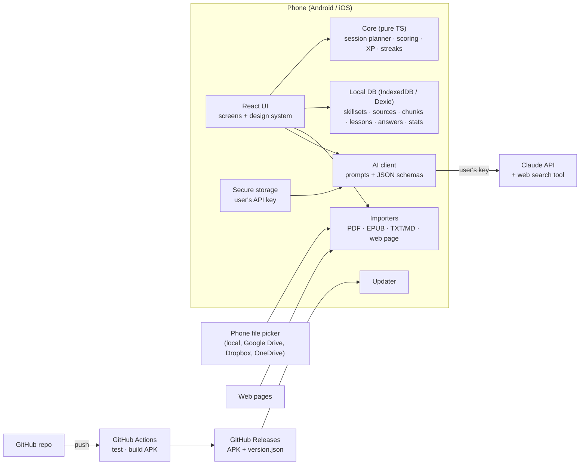

# PES Mobile App — Architecture

**Status:** decided 2026-10-23 — option A (see ADRs)

## 0. "Should it be a web app to avoid version problems?"
**Mostly yes.** Writing the app once in web technology (HTML5 + TypeScript) gives one codebase for Android, iOS and the browser, and lets the app update without waiting for store review. A pure web app alone falls short on three of your requirements, though: no APK or store listing, weak reminders on iPhone, and no secure place for the API key. The usual answer is a **web core inside a thin native shell** (Capacitor): the same web code ships as an APK/iOS app, gets native file access, notifications and secure storage, and can still pull updates from GitHub.

## 1. Options

| | **A. Web core + Capacitor shell** *(recommended)* | **B. Pure web app (PWA)** | **C. Expo / React Native** |
|---|---|---|---|
| What it is | React + TypeScript web app, packaged as Android/iOS apps by Capacitor; also runs in a browser | Same web app, installed from the browser ("Add to home screen") | Native UI written in React Native |
| APK / stores | Yes / Yes | No APK; Play only via a wrapper later; App Store no | Yes / Yes |
| Updates from GitHub | Yes: CI builds the APK into GitHub Releases, app offers the update; later live web-layer updates | Instant: every push to GitHub Pages | Via Expo's update service, not GitHub |
| Files incl. Google Drive / Dropbox | Phone's file picker | Browser file picker | Phone's file picker |
| Reminders on iPhone | Native local notifications | Limited | Native |
| Secure key storage | Keychain / Keystore | Browser storage only | Keychain / Keystore |
| Fit for you as co-developer | HTML/CSS/TS, close to the current hub | Same | React Native specifics, more native tooling |
| Cost for MVP | $0 (GitHub Actions free for public repos) | $0 | $0 with Expo free tier and queues |

### Decision matrix (1–5, weighted)

| Criterion | Weight | A | B | C |
|---|---|---|---|---|
| Updates straight from GitHub | 3 | 4 | 5 | 2 |
| APK now, stores later | 3 | 5 | 1 | 5 |
| Time to MVP | 2 | 4 | 5 | 3 |
| Native features (files, reminders, secure key) | 2 | 4 | 2 | 5 |
| Easy for Oleg + Claude to maintain | 2 | 5 | 5 | 3 |
| Native look and feel | 1 | 3 | 3 | 5 |
| **Weighted total** | | **56** | **45** | **48** |

**Recommendation: A.** It matches all nine points: APK now, store path later, updates from GitHub, one web codebase.

## 2. Recommended architecture (A) in detail



| Layer | Choice | Why |
|---|---|---|
| UI | React 19 + TypeScript + Vite | Mainstream, fast, easy to co-develop |
| Native shell | Capacitor 8 | Same web code → Android/iOS; plugins for files, notifications, secure storage |
| Styling | CSS variables (design tokens) + component CSS | Readable for you; light theme later = one token set |
| Local data | IndexedDB via Dexie; versioned schema; JSON export | Works offline and in the browser |
| Sources | Phone file picker; pdf.js for PDF; EPUB via JSZip; web pages via native HTTP | Covers local files and cloud drives without OAuth setup |
| Lesson engine | Sources → chunks (≈ pages/sections) → curriculum; each session takes the next chunk(s) sized to the minutes chosen | Large books never sent whole; lessons follow the source order |
| AI | Claude Messages API from the device with the user's key; JSON-only responses checked against schemas; web search tool when "use internet" is on; provider interface for others later | No server needed, cost on the user's key |
| Updates (dev) | Push → GitHub Actions builds signed APK → GitHub Release; app checks the latest release and offers install | "Updates directly from my GitHub" |
| Updates (public) | Play Store / App Store; optional live web-layer updates later | Store rules |
| Later (M3) | Supabase (free tier): accounts, leaderboard, sync | Only when needed |

### Build constraint
My workspace can't reach Google's Android build servers, so **APKs are built by GitHub Actions** (free for public repos). That needs the code on GitHub, either pushed by me (if you connect GitHub to Claude) or by you from your Mac.

### Repository
New **public** repo `pes-app` (the app has no secrets thanks to BYOK; a public repo lets the app check for updates without a token). Your existing `Personal-Education-System` repo stays private with your notes. Locally: `Personal Education System/pes-app/` (ignored by the parent repo).

```
pes-app/
  src/
    build.ts      everything decided at build time: version, app id, Play URL, site, endpoints, flags (ADR-036)
    app/          App shell, routing, theme, tab bar, update prompt
    screens/      one file per screen; big screens keep their parts in a folder:
      session/    lesson pages, loading status, result screen (Session.tsx = the flow)
      settings/   Profile, AI, Data, About sections with their sheets (Settings.tsx = the page)
      aiText.ts   how AI errors and providers are put into words (shared by screens)
    components/   design-system pieces and shared widgets (ui, visuals, WormGame, FreeAi…)
    core/         pure logic + tests (planner, scoring, xp, streak, energy, flow, game…)
    ai/           provider registry and client, prompts, tool schemas, keys
    data/         Dexie DB, repositories, session service, reports, logs, backups
    native/       thin wrappers over Capacitor plugins (share, haptics, reminders, TTS, awake, Google sign-in)
    sources/      importers and chunking
    courses/      built-in courses (9 languages)
    update/       GitHub release checker (self-update builds only)
  site/           chompbook.online (static pages + report Worker)
  android/        Capacitor Android project
  .github/workflows/android.yml
  docs/           brief, architecture, store and legal notes
  CLAUDE.md       working rules for Claude
```

## 3. Milestones
- **M1 — MVP on your Android phone:** everything in the brief's M1 scope + CI + self-update.
- **M2:** iOS build (your Mac/Xcode), daily reminders, light theme, flashcards with spaced repetition.
- **M3:** accounts, leaderboard, sync across devices (Supabase); direct cloud-folder sync.
- **M4:** store releases (Play, App Store), Russian UI, more AI providers.

## 4. ADRs

### ADR-001 — Web core in a Capacitor shell
- **Context:** one codebase for Android, iOS and browser; updates from GitHub; Oleg co-develops in web tech.
- **Decision:** React 19 + TypeScript + Vite, packaged with Capacitor 8.
- **Consequences:** native features come through Capacitor plugins; UI is custom (no native widgets); iOS build needs Xcode on Oleg's Mac or a cloud builder.

### ADR-002 — Local-first data, no backend in M1
- **Decision:** IndexedDB via Dexie, versioned schema, JSON backup/restore.
- **Consequences:** no accounts, sync or leaderboard until M3 (Supabase planned).

### ADR-003 — Bring-your-own Claude key, calls from the device
- **Decision:** the user's key lives in Android Keystore / iOS Keychain (`@aparajita/capacitor-secure-storage`); the app calls the Messages API directly. Structured output via forced tool calls; internet research via the server-side web search tool. Default model `claude-sonnet-5-5`, user can pick any model from `/v1/models`.
- **Consequences:** no developer secrets anywhere; API cost and rate limits are the user's; a provider interface can add other LLMs later.

### ADR-004 — APKs built by GitHub Actions, self-update from GitHub Releases
- **Context:** Claude's workspace cannot reach Google's Android build servers.
- **Decision:** public repo `helgurkonungson/pes-app`; each push builds and tests; a new `package.json` version publishes Release `vX.Y.Z` with the APK; the app checks `releases/latest` and offers the download — automatically once per local day (first launch or first return to the foreground; result cached in `profile.updateCheck`, a failed check is not recorded) with a pop-up that never opens over a lesson, and on demand in Settings (0.5.1). Release signing key kept in GitHub secrets.
- **Consequences:** every shipped change needs a version bump + CHANGELOG entry; losing the signing key means reinstalling the app (back it up).

### ADR-005 — Lesson engine: sources → chunks → time-sized sessions
- **Decision:** imported text is split into ~1,500-word chunks following the source's structure; a session plan converts minutes into theory words, quiz size and how much source to feed; the cursor moves through chunks in order; review uses the last lesson's key points and recent mistakes.
- **Consequences:** big books are never sent whole; coverage % is measurable; a 15-min portion teaches ≈ 5,000 source words.

### ADR-006 — Lessons without AI (offline engine)
- **Context:** AI may be unavailable: no key, no internet, or the account ran out of credits (Oleg, 2026-10-23). The app must stay useful.
- **Decision:** `src/core/offline.ts` builds lessons on the device from the learner's sources: the next ~(minutes × 0.6 × 180) words are read (cursor = chunk + word offset, stops at paragraph ends), fill-in-the-gap questions are generated from that text (same-script distractors, grammatical endings matched), and the open question is self-checked against key sentences. `aiState()` decides per session: AI when it works; “credits/auth” errors are remembered in the profile (credits retried after 6 h) and the session falls back automatically; network errors let the learner choose. Settings → “Always without AI” never calls the API.
- **Consequences:** quality without AI is lower than AI lessons but free and offline; offline sessions record `readTo` so AI and offline lessons share the same reading cursor.

### ADR-007 — Course files with id-based progress
- **Context:** ready-made lessons (first: Oleg's private CDO test course) must work without AI and be updatable without losing progress.
- **Decision:** a course is a JSON file `format: "pes-course"` (`src/core/course.ts`) imported into table `courses` (Dexie v2). A skillset points to it via `courseId`. The next lesson is the first lesson whose id isn't in the skillset's finished sessions, so a newer version (same course id) can add, reorder or edit lessons and progress stays. Finished sessions keep a copy of the lesson they taught. Review = previous lesson's key points + its `recall` questions + recent mistakes.
- **Consequences:** course content lives outside the public repo (only a tiny English fixture is in `tests/fixtures`). Authoring tools: `validate.py` / `build_course.py` kept with the course, not in the app.

### ADR-008 — Interface language (i18n)
- **Decision:** `src/i18n` — typed keys, English reference dictionary, Russian with all plural forms (Intl.PluralRules); `useT()` in React, `t()` in services. Language = profile preference or the phone's language; cached in localStorage to avoid a flash on start. Dates via Intl.
- **Consequences:** every UI string goes through `t()`; adding a key to `en.ts` without `ru.ts` fails type-check and a unit test.

### ADR-009 — Progress survives updates
- **Context:** “updates must not reset progress of started skillsets”.
- **Decision:** (1) same app id + release key + default WebView origin (guarded by `src/config.test.ts`); (2) schema changes only additive (`this.version(n)`), migration covered by a test with live v1 data; (3) automatic snapshot of the whole DB into the app's private files after each lesson, import and when the app goes to the background; restored automatically if the DB comes up empty; cleared by “Delete all data”; (4) before installing an update the app writes a backup to Documents/PES (survives uninstall) and onboarding offers “Restore from backup”.
- **Consequences:** a few MB written per snapshot (sources included); acceptable on phones.

### ADR-010 — Test strategy and compatibility
- **Decision:** test pyramid in CI — Vitest unit/integration (fake IndexedDB) → Playwright E2E on Chromium (Android WebView engine) and WebKit (iOS engine) device profiles + desktop, with axe accessibility and layout checks → Android emulator smoke tests of the real APK (API 31/34/36, small phone, tablet). Chromium E2E gates the release; WebKit/Firefox and emulator jobs report until stable. Details: `docs/TESTING.md`.

### ADR-011 — Several AI providers
- **Context:** Oleg wants to use ChatGPT, Alice AI and Qwen keys, not only Claude.
- **Decision:** `src/ai/providers.ts` + `src/ai/compat.ts`: Claude keeps the Anthropic Messages API; ChatGPT (api.openai.com), Alice AI (Yandex AI Studio, `llm.api.cloud.yandex.net/v1`, model URI `gpt://<folder>/<model>`, header `OpenAI-Project`) and Qwen (DashScope compatible mode, intl/China) and NVIDIA (`integrate.api.nvidia.com/v1`, added in 0.3.1) use OpenAI-compatible Chat Completions with function calling; Yandex and NVIDIA get `tool_choice: auto` plus a JSON-in-text fallback. On the phone requests go through Capacitor native HTTP (no CORS). One key per provider in secure storage; the old `anthropic_api_key` name is kept.
- **Consequences:** web research stays Claude-only; lesson quality varies by model; provider error texts are mapped to the same kinds (credits/auth/rate…), so the offline fallback works for all.

### ADR-012 — Gemini, Groq and custom OpenAI-compatible servers
- **Decision:** same OpenAI-compatible client. Gemini: `generativelanguage.googleapis.com/v1beta/openai` (Bearer key, tool_choice auto + JSON fallback, ids may come as `models/…`). Groq: `api.groq.com/openai/v1` (forced function). Custom: user-entered base URL (http allowed, key optional, model from `/models` or typed). Readiness = key saved, or for custom: address + model (`providerReady()`). A 400 mentioning tools triggers one retry with `tool_choice: auto` (then without tools). **0.4.2:** transient 5xx (500/502/503/529) are re-sent twice (2 s, 5 s); a request that still fails with 5xx/504 is sent once more without tools, with the JSON schema in the system prompt. Gemini: `reasoning_effort: low` for 2.5+ models (dropped on a 400 that mentions reasoning/thinking) and `max_tokens` + 4096 for thinking; error bodies may be an array `[{error:{code,message,status}}]`. The session error screen shows status + provider message.
- **Consequences:** `android:usesCleartextTraffic="true"` so the app can reach LAN servers over http (only native HTTP; the WebView keeps blocking mixed content). Local models vary a lot in quality and speed — custom requests get a 10-minute timeout.

### ADR-013 — AI lessons written in resumable steps
- **Context:** Gemini (free tier especially) kept failing on the single large "write the whole lesson" request — long thinking, 5xx/504 and per-minute limits — and when the phone fell asleep the request died and the next try started from zero.
- **Decision:** a lesson is generated in small requests: plan (title, section headings + focus + which excerpts, key points, open question) → one request per theory section (only its excerpts) → review → quiz (written from the theory actually produced). After every step the partial result is saved in a `LessonDraft` (Dexie v3, table `drafts`, one per skillset). `prepareSession` reuses a draft with the same portion and the same source chunks (≤ 3 days old) and deletes it when the lesson is saved. A malformed step is re-asked once. Per-minute 429s with a short "retry in Ns" are waited out (≤ 65 s, twice). While writing, the screen is kept on (own `ScreenAwake` plugin: `FLAG_KEEP_SCREEN_ON`; Screen Wake Lock API on the web). If a step fails with a network/5xx error after the app was in the background, the session screen does not show an error: it waits until the app is visible and continues from the draft automatically (up to 3 times).
- **Consequences:** 4 + N requests per lesson instead of 1 (source excerpts are sent to the plan and to their section only) — more input tokens, but each answer is short, so it finishes within provider limits; progress shows "step i of n". Applies to all providers, Claude included. A true background service is not used: when the OS suspends the app, work stops and resumes from the last saved step.

### ADR-014 — Book hygiene: skip front/back matter, clean extracted text
- **Context:** lessons without AI started with the title page, copyright, contents and preface, full of control characters and PDF debris — unreadable.
- **Decision:** `src/core/cleanText.ts`. `cleanSourceText` (idempotent): NFKC, removes control/zero-width/private-use/replacement characters, soft hyphens, dot leaders, page-number and symbol-only lines, joins line-end hyphenation; applied in the chunker on import and again when lessons are built (so existing books benefit and reading offsets stay consistent). `analyzeChunks` per source: content starts at the first "Глава/Chapter/Часть/Part 1" heading in the first half that is followed by prose and is not on a contents page — earlier chunks are skipped and that chunk is trimmed to the heading; without such a heading, chunks near the start that look like imprint (ISBN, ©, УДК/ББК…), contents (short lines ending in page numbers) or carry front-matter headings (предисловие, введение, preface, introduction…) are skipped; near the end: index, bibliography, notes. Near-empty chunks are skipped. A source is never skipped entirely. `lessonChunks()` is used for offline and AI lessons.
- **Consequences:** heuristics — an unusual book may keep some front matter or (rarely) lose an introduction the learner wanted; chunks themselves are not changed in the database, so the behaviour can be tuned later without migrations.

### ADR-015 — Start AI lessons early; finish them in the background
- **Decision:** `generateLesson` writes plan → review → parts → quiz and calls `onPartial` with an assembled partial lesson (`lesson.building = {done, total, sections, error?}`) once the review and part 1 exist. `sessionService.writeAiLesson` saves the session at the first partial and returns it (the screen's cancel only aborts before that point); later partials and the final lesson are written with `db.sessions.update(id, { lesson })` only — the screen writes only progress/status, so neither overwrites the other. Questions are shuffled with fixed seeds so their option order is stable across partials. `lessonPages` ends a building lesson at a `pending` page (cannot advance); the session screen follows the record with Dexie `liveQuery`. Failures after the start set `building.error`; `continueWriting(sessionId)` resumes from the draft (on opening the lesson, on returning to the app, Retry on the pending page, or when `prepareSession` finds such a session). One writer per session (in-memory map; `continueWriting` registers itself before its first await). **0.9:** writers save through `storeWrittenLesson` (a transaction that keeps the stored review and never turns a finished lesson back into a building one), the final lesson is stored before its draft is deleted, and `refreshReview` patches only the review of the freshly read record — a stale copy had overwritten finished lessons, which then lost their draft and were dropped.
- **Consequences:** the learner usually waits only for plan + review + part 1. If the app is killed, writing resumes next time the lesson is opened.

### ADR-016 — Placement test first, for every kind of material
- **Decision:** `needsPlacement(skillset)` (core/scoring): no placement result and not skipped — or skipped by an older version while no lesson is done. Tests: AI (`generatePlacement`, numbered excerpts, each question's `excerpt` → `Mcq.ref` = chunk id), offline (`buildOfflinePlacement`: one gap question per sampled chunk, `ref` = chunk id; null when < 3 questions → start from zero), course (`buildCoursePlacement`: hardest quiz question of up to N lessons spread over the course, `ref` = lesson id). If the AI can't write the test (no credits/key), the offline test is used. `scorePlacement` adds `known` = refs whose every question was right. `skipPlacement` stores `skippedPlacement()` (beginner, nothing known, `skipped: true`) and removes an unfinished test. Lessons: `lessonChunks(chunks, placement.known)` (offline + AI) and `coveredLessonIds(done, known)` for the next course lesson; AI prompts get "ALREADY KNOWN … don't re-teach" from strengths and "assume no prior knowledge" when skipped. First lesson (no finished lesson yet): AI skips the review step, offline/course lessons have no review.
- **Consequences:** a learner who gets material right never sees it in lessons (they can still read sources); with few chunks the offline test may be impossible → start from zero.

### ADR-017 — Spaced repetition, intermediate tests and the final test instead of an AI review
- **Decision:** every answered question becomes a Leitner card (`src/core/srs.ts`, Dexie v4 table `cards`, index `[skillsetId+due]`): boxes 0–6, intervals 1/3/7/14/30/60 days, a wrong answer sends it back to box 0. The review step is built by the app (`sessionService.buildReview`), never by the AI: cards due today (≤ 6) plus the last lesson's key points; every 5th lesson (`CHECKPOINT_EVERY`, ≥ 4 cards) it is an **intermediate test** of 8 cards picked round-robin by topic, weakest first (`lesson.checkpoint`, result `checkpoint {correct,total}`); when all material is covered (sources read to the end, or the last course lesson done) a **final test** session (`kind: "final"`, 15 cards, `skillset.final`) comes before "finished". A ready lesson gets its review refreshed when it is started on a later day. Placement uses 2 questions per part; a part counts as known only if both are right ("I don't know" = wrong). Without AI the open question is left out (`lessonPages(l, {open:false})`) — nothing could grade it.
- **Consequences:** one fewer AI request per lesson; reviews work identically with and without AI. Old lessons keep their stored review.

### ADR-018 — Reminders, listening, error journal, token usage
- **Decision:** reminders with `@capacitor/local-notifications` (inexact alarms, `SCHEDULE_EXACT_ALARM` removed from the manifest): 7 days of daily reminders at the chosen time (with due-card count) + a 21:30 "streak at risk" nudge, re-planned on start/resume/after a lesson (`core/reminders.ts` pure, `native/reminders.ts`); offered once after the first lesson. Listening: `@capacitor-community/text-to-speech` (phone's own engine, offline) / Web Speech API; Markdown stripped, spoken in sentence pieces ≤ 1500 chars. Error journal: Dexie table `logs` (last 200), window errors, unhandled rejections, AI and import errors; secrets masked by pattern before writing; sent only by the learner through the share sheet. Token usage: Anthropic `usage` / OpenAI-compatible `usage` per request → `lesson.usage` and `profile.usage[YYYY-MM]`.

### ADR-019 — Automatic offline OCR for scanned PDFs
- **Decision:** PDF pages whose text layer has < 25 letters are rendered with pdf.js (~2000 px long side) and recognised with tesseract.js 7 (LSTM only) and the Russian + English `best_int` models. The engine ships inside the APK (`tools/ocr-assets.mjs` copies worker, SIMD/non-SIMD cores and models into `public/ocr` at every Vite start; gitignored) — no CDN, no network, pages never leave the phone; loaded lazily only when a scan is found. The learner does nothing extra: progress "Recognising text on page i of n", a toast with the number of recognised pages.
- **Consequences:** APK +~13 MB; recognition takes a few seconds per page on a phone; quality depends on the scan. Engine start is capped at 60 s and each page at 90 s; on a timeout or error the import continues without OCR and the reason is logged. In Playwright WebKit the engine start hangs (CI 0.9.0), so the OCR e2e test runs on Chromium and Firefox only — check again with the iOS app.

### ADR-020 — Every CI gate blocks the release; bilingual release notes
- **Decision:** the `release` job runs after `build`, `e2e-cross` (WebKit, Firefox) and `device-tests` (emulators) all pass; nothing is `continue-on-error` any more. Emulator smoke: system error dialogs hidden, the (unused) Pixel Launcher disabled for the run — API 34 images kept raising "Pixel Launcher isn't responding" over the app — a render retry, and one full retry of the script. Release notes: `tools/release-notes.mjs` writes `<!--lang:ru-->` (CHANGELOG.ru.md) and `<!--lang:en-->` (CHANGELOG.md) sections; the update pop-up shows the section of the UI language (`notesForLang`).
- **Consequences:** a red emulator run now delays the APK; re-run the job if an emulator image misbehaves.

### ADR-021 — Free Gemini key in one tap, with explicit consent
- **Context:** Oleg wants AI available without the learner hunting for an API key, ready for Google Play and the App Store. Shipping a developer key is not an option (free-tier data use, EEA/UK/CH paid-only, extractable key, shared tiny quota).
- **Decision:** each learner gets their **own** free Gemini key. A consent sheet (data use on the free tier, regions, 18+, Gemini API terms; checkbox required; stored as `profile.geminiConsent`) precedes everything. If the build has a Google OAuth client (`VITE_GOOGLE_WEB_CLIENT_ID` / `VITE_GOOGLE_IOS_CLIENT_ID` from GitHub variables), a native in-app Google sign-in (`@capgo/capacitor-social-login`, Google only; Credential Manager + AuthorizationClient on Android, MainActivity forwards the authorization result) gives a one-time `cloud-platform` token; `src/ai/geminiSetup.ts` then finds/creates a labelled `chompbook-*` project (Resource Manager v1), enables `generativelanguage.googleapis.com` (Service Usage), creates/reuses an API key restricted to that service (API Keys v2), reads it and retries the check while it propagates. The token is not stored and the app signs out. Otherwise — or on failure (terms not accepted, project quota, misconfiguration) — Google AI Studio's key page opens in an in-app browser and the copied `AIza…` key is read from the clipboard on return (paste field as last resort). WebView-embedded Google sign-in is never used (Google blocks it).
- **Consequences:** the one-tap path needs Oleg's Google Cloud setup and, for production, Google's OAuth verification of the sensitive `cloud-platform` scope (until then: test users only, "unverified app" screen) — see `docs/GEMINI_SETUP.md`. Gemini becomes the active provider with the newest Flash model.

### ADR-022 — Light theme
- **Decision:** colours stay tokens; `:root[data-theme="light"]` redefines them (off-white background, white cards with a hairline, darker status colours). Accent *text/icons/outlines* use `--accent-ink` (= the yellow in dark, deep amber `#8f5f00` in light, AA on white); yellow *fills* (primary buttons, toggles) stay `--accent`. Text on cover artwork is always white. `profile.theme` = system | light | dark (default system), applied by `src/app/theme.ts` (data-theme, theme-color meta, SystemBars style) and mirrored in localStorage so the first paint is right. Playwright runs with `colorScheme: dark` by default; a dedicated test switches to light and checks AA contrast on every main screen.

### ADR-023 — Age only when connecting AI; assisted free connections (Groq, Mistral, OpenRouter)
- **Context:** the widest possible audience and store featuring, while every free AI tier has its own minimum age (checked 2026-10-25: Gemini 18+, Groq 18+, OpenRouter 18+, Mistral 13+ with parental permission under 18).
- **Decision:** the app itself has no age requirement. Before connecting any service from the "Connect a free AI" list (and before the Gemini flow), a neutral age screen asks for the birth year once; only `profile.ageGroup` (child/teen/adult, computed conservatively) is stored. Services below the learner's band are shown disabled ("from 18"); teens get Mistral with a parent-permission checkbox; children can't connect AI (lessons without AI still work). Groq, Mistral and OpenRouter are connected by opening their key page in the in-app browser and picking the copied key from the clipboard (`src/ai/freeProviders.ts` patterns), with a per-service consent (`profile.aiConsents`). New providers: Mistral (`api.mistral.ai/v1`, default `mistral-small-latest`) and OpenRouter (`openrouter.ai/api/v1`, attribution headers, key verified via `/key`, a `:free` model picked by default). Manual key entry for other providers stays unrestricted.
- **Consequences:** store target audience 13+ (see `docs/STORE_PUBLISHING.md`); Families/Kids programmes stay out of reach because of third-party AI.

### ADR-024 — Nine interface languages, each loaded on demand
- **Decision:** UI languages en, ru, uk, be, es, de, fr, zh (Simplified), hi. English is the reference dictionary and the only one in the main bundle; every other dictionary is its own chunk, loaded by `initLang()` before the first render and by `useLang.set()` before switching (no flash of English). The phone's language list picks the first supported language (kk/ky/tg → ru, other unsupported → en). Language pickers are bottom-sheet lists (`src/components/LanguagePicker.tsx`). Lesson languages grew to the same nine plus "as sources" (`src/core/languages.ts`); Chinese lessons are asked for as *Simplified Chinese*. Speech picks ru/uk/be by letters, zh/hi by script and es/de/fr/en by frequent words (`speechLang`).
- **Consequences:** every new UI string goes into all nine dictionaries; the unit test checks keys, placeholders and every plural form `Intl.PluralRules` needs (uk/be: one/few/many/other; es/fr: one/many/other). The Android app name stays "Chompbook" except Russian («Грызи»). E2E checks each language's onboarding, tutorial, tabs and Settings at phone width for horizontal overflow.

### ADR-025 — "Report this lesson" (AI-generated content rules)
- **Context:** Google Play's AI-Generated Content policy requires in-app reporting of offensive AI output without leaving the app; App Store guideline 1.2 asks for a way to flag objectionable content. It must not get in the way of studying.
- **Decision:** a small flag icon at the right of the lesson's top bar (next to the timer) and in a saved lesson's top bar; AI lessons are labelled "Written by AI" on their first page. The flag opens a sheet: reason (harmful, offensive, wrong, low quality, other), optional comment; the text on screen, step, lesson title, provider and model are attached (`src/core/report.ts`), keys/personal data never (secrets are redacted). Reports are saved first (Dexie v5 table `reports`, additive) and delivered to `VITE_REPORT_URL` (HTTPS JSON POST; retried at start) when the build has it; otherwise "Send to developer" opens the mail app with a ready e-mail to `support@chompbook.online` (`DEFAULT_REPORT_EMAIL`; a build can override it with `VITE_REPORT_EMAIL`). Settings → Lesson reports lists them.
- **Consequences:** for store review, set `REPORT_URL` (→ `VITE_REPORT_URL`, e.g. a form backend or a tiny serverless function) as a GitHub Actions variable so reports reach the developer silently; it is called with the WebView's `fetch`, so it must answer CORS for the app origin (`https://localhost`) and accept `content-type: application/json`. Until then reports are sent by hand.

### ADR-026 — First-run tutorial
- **Decision:** five animated slides (CSS only, respects reduced motion) after onboarding: sources → portion → lesson steps → streak & cards → AI optional + the report flag. Skippable on every slide; a skip shows a 6-second message "Settings → Watch the tutorial". `profile.tutorial` = pending | done | skipped; learners who started before 0.13 (field unset) don't get it automatically. Swipe, arrow keys, Esc and the Android back button work.

### ADR-027 — Smaller app (0.13.0)
- **Decision:** (1) only the SIMD build of the OCR engine ships (−3.9 MB raw / ~1.5 MB in the APK; every supported WebView has WebAssembly SIMD; without it OCR reports an error and the import continues); (2) R8 shrinks the release build (`minifyEnabled`, `shrinkResources`) with keep rules for every Capacitor plugin package and `res/raw/keep.xml` for resources looked up by name; (3) Android images are lossless WebP (−39 %); (4) rarely opened screens (Settings, Progress, Onboarding, Sources, edit, history, logs, reports, tutorial) and the eight non-English dictionaries are lazy chunks — the start-up script shrank from 642 kB to ~525 kB; (5) dead code and the `wasm-feature-detect` dependency removed. Offline OCR language data (rus+eng) stays in the APK by Oleg's decision.
- **Consequences:** R8 can only be verified on CI (the emulator smoke tests run the release APK); if a plugin breaks, add a keep rule instead of turning R8 off.

### ADR-028 — Free AI in one tap: OpenRouter OAuth first, the offer depends on the country
- **Context (checked 2026-10-26):** the Gemini API answers "User location is not supported" in Russia, Belarus, China and a few other countries, and its free tier may not be used in the EEA, the UK and Switzerland — the automatic Gemini key failed there after a minute of retries. GitHub Models was retired (30 July 2026), Pollinations dropped anonymous access. OpenRouter offers OAuth with PKCE for public clients (no developer secret): the user signs in (Google, GitHub or e-mail), OpenRouter redirects with a one-time code (valid 10 minutes) and `POST /api/v1/auth/keys {code, code_verifier}` returns the user's own key. Free models: 20 requests/min, 50/day (1000/day after $10 of credits) — about 8 lessons a day.
- **Decision:** (1) `src/ai/openrouterOAuth.ts` (pure, tested): S256 verifier/challenge, sign-in URL with `callback_url=https://chompbook.online/oauth/openrouter/?state=…`, pending sign-in in `localStorage` for 10 minutes (survives Android killing the app), state check, code exchange. (2) The callback page (`site/public/oauth/openrouter/`) only forwards the query to the app: `intent://oauth/openrouter?…#Intent;scheme=io.github.helgurkonungson.pes;package=…;end` on Android (plus a button, since Chrome may require a tap), `postMessage` to the opener on the web. (3) Android: `VIEW` intent-filter for `io.github.helgurkonungson.pes://oauth`; `App.tsx` handles `appUrlOpen`, the launch URL, the web message (origin `https://chompbook.online`) and a `pes:deeplink` event used by tests; `src/ai/openrouterConnect.ts` (zustand) finishes the sign-in even if the sheet was closed, closes the in-app browser, verifies the key and makes OpenRouter the provider. (4) `src/core/freeAiPlan.ts` picks what the free-AI sheet shows from the age group and the phone's time zone (no network, nothing sent): adults get OpenRouter first everywhere and Gemini second where it works; elsewhere Gemini moves under "Other services"; teens get Mistral only. (5) Gemini setup and manual checks recognise the location error (`isRegionBlocked`), stop retrying and offer OpenRouter.
- **Consequences:** the callback page must be deployed with the site before the release (the app's sign-in returns there). The code in the callback URL is useless without the verifier that stays on the phone. OpenRouter is 18+ and its free tier may train on prompts — the consent screen says so. Next: GigaChat (Sber, freemium for individuals, works in Russia) as an extra service — it needs the Russian root CA and native HTTP, so it is not in this release.

### ADR-029 — Energy, streak freezes, rest days and repair (one economy)
- **Context:** XP, streaks and missed days were unrelated: XP only fed levels, a single missed day reset the streak to zero, and nothing could be earned or spent. The monetisation plan (after the release) is a hosted AI with a subscription; it needs a unit that AI actions can cost. Until then every AI call runs on the learner's own key (BYOK), so nothing may be charged for AI.
- **Decision:** (1) **Energy** (`profile.energy`) is earned in `completeSession` by `core/energy.ts`: +5 for any finished session, +1 per right review answer (spaced-repetition cards), +5 for a lesson without mistakes (≥ 3 questions), +5 for a passed intermediate test and +15 for a passed final test (≥ 70 %), +20/+50/+100 when the streak reaches 7/30/100, +10 for the first lesson after ≥ 2 missed days, +15 for a "clean week" (last Mon–Sun: every day a lesson or a rest day; a freeze doesn't count; paid once, `profile.cleanWeek`). The result screen lists what was earned. (2) **Freezes** (`profile.freezes`, max 2) cost 50 energy and are spent automatically; a freeze is never spent on a streak that breaks anyway. (3) **Rest days** (`profile.restDays`, ≤ 2 weekdays): they keep the streak for free, get no reminders and no evening nudge. (4) **Repair**: after exactly one missed (non-rest) day, two lessons the next day win the old streak back (+ today); no freeze needed. (5) Missed days are settled lazily by `settleStreak` (pure, idempotent per day) on start, on return to the app and before a session is closed; history of rest/frozen days stays in `streak.kept` for the calendar (newest 60). (6) Children and teens (age band from ADR-023) get no "streak ends tonight" nudge. (7) No schema change: only optional profile fields; backups carry them.
- **Consequences:** energy has one sink (freezes) until the hosted AI arrives; then AI actions there will cost energy (a daily free allowance, packs and the subscription), never AI on the learner's own key. Energy packs and the subscription need payments (Google Play Billing / RuStore Pay) and a sole-proprietor status — planned after the release.

### ADR-030 — The waiting game (worm vs birds)
- **Decision:** while a lesson is prepared (and on a page whose part is still being written) the book animation gives way to a one-tap game: a worm hops (tap/Space/Enter/↑), gravity pulls it down, birds fly in from the right — some swoop — and speed up with the score; touching a bird or the ground ends the round. Physics and scoring are pure (`src/core/wormGame.ts`, unit tested, deterministic for a given random source); `src/components/WormGame.tsx` draws it on a canvas with theme tokens (`--worm`, `--soil`, the book blue for birds) in one `requestAnimationFrame` loop that pauses while the app is hidden. The record is kept in `localStorage` (a per-device convenience; losing it is harmless).
- **Hand-over:** `prepareSession` no longer switches the phase itself: it sets `readyPhase`, and the game calls `onDone` — at once when nobody is playing, after the round when one is on ("The lesson is ready — finish your round!"). On a pending page the game sits outside `PageView` (`PendingWait`), so a round started there survives the part's arrival (`gamePage`), and the page opens after the crash. The writing progress, Retry and the report flag stay as they were; lessons without AI are unaffected.


### ADR-031 — Built-in starter courses and the tutorial's last step
- **Decision:** five free starter courses ship inside the app — How to learn effectively, AI literacy, Data and spreadsheets, Financial literacy, Critical thinking — 8 lessons each, in all nine interface languages (45 files). They are authored as text in a compact format (`src/core/courseText.ts`: `#` lesson, `##` theory section, `!key`, `?q`/`?r` questions with `+`/`-` options and `=` explanation, `!open`/`!rubric`/`!model`) and turned into the regular `pes-course` JSON, so they run through `parseCourse`/`importCourse` like any imported course: no AI, no network, self-checked open questions (ADR-006). Options are written right-answer-anywhere and shuffled deterministically (FNV-1a of `lessonId/q|rN` → seeded Fisher–Yates), so every translation has the answer in the same position; `courses.test.ts` checks that each translation has exactly the original's structure (lessons, sections, key points, option counts, answer index, difficulty, rubric) and the right script.
- **Install:** each file is a lazy chunk (`import.meta.glob`, non-generic form — the generic one isn't transformed by this Vite). `installBuiltinCourse(slug, lang)` imports the course in the interface language (course id `cb-<slug>-<lang>`), skips the placement test (the courses start from zero), and returns the existing skillset on a second tap; a newer bundled `version` is imported over it with progress kept.
- **Where:** the tutorial gains a sixth, last step "Where shall we start?" (no Skip; "Decide later" closes it): the five courses — one tap opens lesson 1 directly (Skillsets → course → session) — or "Create my own skill", a short path: how a skill works → why AI helps → connect it (free AI with its catches → the existing free-AI sheet; Chompbook AI → the `pro` placeholder screen until payments exist; own key → how to get a token, then Settings opens at the provider picker via `nav/intent`) or continue without AI → New skillset. With AI already working the connect step only confirms it. The Skillsets screen lists the same courses under "Free courses".
- **Content rules:** educational, not advice (money course says so); facts limited to well-established sources (Ebbinghaus, Roediger & Karpicke, Rohrer & Taylor, Pashler et al., Gollwitzer, Warren & Warren Tyagi, Kahneman & Tversky, Wald, Stanford History Education Group); spreadsheet function names follow each language's Excel (French Excel names with `;`, others English).

### ADR-032 — Free OpenRouter models under load
- **Problem:** free `:free` models are shared; at peak hours the upstream provider answers 429 "temporarily rate-limited upstream" without a "retry in", and the app failed the lesson at once. The daily cap ("free-models-per-day", 50 requests without credits, 1000 with ≥10 credits) looked the same to the learner.
- **Decision:** requests to a free OpenRouter model send `models: [model, "openrouter/free"]`, so OpenRouter falls back to its free-models router by itself; a 429 from OpenRouter without a wait hint is retried after 8 s and 20 s (`retryPolicy.busyWaitsMs`), but never a daily cap (`isDailyLimit`, which now also matches `per-day`). The error screen adds a specific line: the daily limit (resets within 24 h; 10 credits raise it to 1000/day) or "free models are busy, try again in a few minutes". The tutorial's free-AI page states these catches up front (limits, busy hours, training on free tiers, weaker/changing models, age and country).

### ADR-033 — Report endpoint on chompbook.online; error reports by button or opt-in
- **Context:** lesson reports (ADR-025) had no endpoint (`REPORT_URL` unset → e-mail), and the error journal (0.9.0) reached the developer only through the share sheet, so most problems were never seen.
- **Decision:** the site's Worker (`site/`, Cloudflare Workers Builds) gets `site/src/worker.ts`: `POST /api/report` (the rest is still static assets; `run_worker_first: ["/api/*"]`). It accepts `{ app: "chompbook", reports?: LessonReport[], logs?: { version, platform, ua, lang, auto, entries[] } }` (≤ 256 KB, ≤ 20 reports, ≤ 200 entries), keeps only known fields, cuts them and redacts key-like strings again (`site/src/report.ts`, unit tested with the app's tests), answers CORS only for the app's origins (`https://localhost`, `capacitor://localhost`, local dev, the site), limits 20 requests/min per IP (Workers rate-limit binding `LIMIT`; IP not stored), stores one row per lesson report / journal in D1 `chompbook-reports` (table `reports`, created on first use; country from `cf.country`) and sends a short plain-text notice to Telegram (secret `TG_BOT_TOKEN`, var `TG_CHAT_ID` in `site/wrangler.jsonc`; a failed notice never fails the request). In the app, `REPORT_URL` comes from `src/build.ts` (ADR-036; first `src/data/endpoint.ts`) (GitHub Actions variable `REPORT_URL` = `https://chompbook.online/api/report`); Settings → Error log's button posts the newest 100 entries (`src/data/logSend.ts`, pure parts in `src/core/errorLog.ts`) and falls back to the share sheet when there is no endpoint or it fails. "Send error reports automatically" is **off by default** (`profile.autoErrorReports`); turning it on starts from that moment (`logsSentId`), then problems (never `info`) are posted 20 s after they are logged and at app start, at most 30 entries and once per 10 minutes (`logsAutoAt`). Privacy policy section 3 describes both.
- **Consequences:** reading reports: Telegram notice, full rows in the Cloudflare dashboard (D1 → `chompbook-reports` → Console, e.g. `SELECT id, received_at, type, version, summary FROM reports ORDER BY id DESC LIMIT 50`). E2E builds have no endpoint, so Playwright covers the share-sheet path; the endpoint path is covered by unit tests (fake fetch / fake D1) and was checked once by hand against a build with `VITE_REPORT_URL`. Delete rows older than 12 months by hand until a scheduled cleanup exists.

### ADR-034 — Google Play: app id online.chompbook.app, no self-update, AAB
- **Context:** the app goes to Google Play under the organisation account with the package `online.chompbook.app`; GitHub builds used `io.github.helgurkonungson.pes`. An installed app's id can't change. Oleg chose a single id (no parallel GitHub app).
- **Decision:** `applicationId` and the Capacitor `appId` are `online.chompbook.app` (the Java package / namespace stay `io.github.helgurkonungson.pes` — code only). The OpenRouter deep-link scheme follows the id; the sign-in URL carries `app=online.chompbook.app`, and the callback page opens that app, or the old id for builds before 0.19. The GitHub self-updater is compiled out of the default build (`__SELF_UPDATE__` = `VITE_SELF_UPDATE=1`), because Play forbids updating outside Play; Settings shows the version and links to the Play listing. CI builds the APK (direct install, emulator smoke) and a signed **AAB** (`Chompbook-x.y.z-play.aab`), attached to each GitHub Release. Upload key = the existing release key (Play App Signing re-signs). Users of the old GitHub app move their data with Settings → Export backup → restore in the new app (the old app's updater offers v0.19 once; it installs as a separate app). ADR-009 is amended: from now on `online.chompbook.app` must never change.

### ADR-036 — Module boundaries for the next features (0.19.1)
- **Context:** the next steps are Chompbook Pro (a hosted AI with a subscription: a new provider, a paywall, store purchases, new error states), a RuStore build and iOS. Several Claude sessions work on the code in parallel. `Session.tsx` (1000 lines) and `Settings.tsx` (630 lines) were single components that every feature touched; build-time switches (`__APP_VERSION__`, `__SELF_UPDATE__`, `VITE_*`) were read in seven files; screens imported each other (Settings and Onboarding took AI error texts from the Session screen); Capacitor plugins (Share, Filesystem, Haptics) were called from screens.
- **Decision:** (1) `src/build.ts` is the only place that reads build-time values (version, repo, app id `online.chompbook.app`, Play URL, site URL, self-update flag, report endpoint, Google client ids). New channels and services add their switches there. (2) `src/screens/aiText.ts` turns AI errors and provider ids into words for every screen. (3) Settings is a page of sections in `src/screens/settings/` — Profile (+ theme), AI, Data, About — each owning its state and sheets. (4) The lesson flow stays in `Session.tsx`; its parts live in `src/screens/session/` (`PageView` with theory/quiz/open/pending pages, `LoadingStatus`, `Congrats`). (5) `src/native/share.ts` (text and file sharing with web fallbacks) and `src/native/haptics.ts` wrap plugins, next to the existing reminders, TTS, keep-awake and Google sign-in wrappers.
- **Consequences:** behaviour is unchanged (same unit and e2e tests). Pro plugs into `aiText.ts` (subscription errors), `settings/AiSection.tsx` (a provider row), `build.ts` (store keys, API URL); iOS differences go into `src/native/`. Rule for new code: screens don't import other screens' files except their own folder and `aiText.ts`; plugins are used only from `src/native/` (and the few platform-specific components that already do).


### ADR-037 — Chompbook Pro: subscription + hosted AI (RevenueCat, Cloudflare Worker, OpenRouter)
- **Context:** the simplest monetisation that keeps the app free and ad-free (Oleg's choice, 2026-10-29): a subscription that removes the hardest step — getting an AI key. Seller: Oleg's sole proprietorship in Armenia; payments only through Google Play Billing. Prices: $4.99/month or $39.99/year with a 7-day free trial; lower prices for CIS countries are set per country in Play Console. Fair use ≈ 10 fifteen-minute AI lessons a day.
- **App:** `@revenuecat/purchases-capacitor` (exact version, R8 keep rules). `src/pro/purchases.ts` configures RevenueCat with the public Android key (`REVENUECAT_ANDROID_KEY` in `src/build.ts`, from the `VITE_REVENUECAT_ANDROID_KEY` variable; empty = Pro isn't sold in that build), keeps the customer info in a store (`usePro`) and mirrors it to `profile.pro`; an anonymous RevenueCat app user id (`$RCAnonymousID:…`) — no account, no e-mail — becomes the "key" of the provider **`chompbook`** ("Chompbook AI", OpenAI-compatible, `PRO_API`, default `https://api.chompbook.online/v1`). The first activation switches lessons to Chompbook AI. `src/screens/Pro.tsx`: paywall with store prices, trial and the renewal text, restore, manage subscription (Play), age gate (not under 13), legal links; without the key (web, test builds) it says where Pro is sold. Settings → AI (`settings/AiSection.tsx`) has a Chompbook Pro row and Chompbook AI as the first provider option; key and model rows are hidden for it. Errors (`screens/aiText.ts`): 402 → "Pro is not active" (renew), 429 "per day" → daily limit, never retried; lessons fall back to no-AI as always (ADR-006). Pure logic (plans, trial length, entitlement, allowance) in `src/core/pro.ts`. Unless the learner said they are 18+, requests carry `x-chompbook-audience: teen`.
- **Server:** `api/` — a Cloudflare Worker at `api.chompbook.online` with D1. It accepts the RevenueCat id as a Bearer token, checks the `pro` entitlement through the RevenueCat REST API (cache: active 10 min, inactive 30 s; if RevenueCat is down, a known active user keeps working for 24 h), enforces a daily token budget per learner (`DAILY_TOKENS`, UTC day, 429 `daily_limit`), and forwards the chat request to OpenRouter with our key, our model (`MODEL`, fallbacks in `FALLBACK_MODELS`), capped output and `tool_choice: "auto"`. Unless the app says the learner is an adult, it adds child-safety rules as the first system message (Anthropic's guidance for products used by minors). It stores no lesson content and keeps no request logs (`invocation_logs: false`); a daily cron deletes usage older than 90 days and cached entitlements unused for 30 days. Secrets (`OPENROUTER_KEY`, `REVENUECAT_SECRET`) live only in Cloudflare.
- **Consequences:** Pro is sold only where Google Play sells subscriptions (not in Russia — RuStore Pay later). The privacy policy (section 3) and the terms of use (`site/public/terms/`) describe RevenueCat, the server and OpenRouter; the Play Data safety answers change (`docs/STORE_FORMS.md`, "With Chompbook Pro"). Setup: `docs/PRO_SETUP.md`.

### ADR-038 — chompbook.online: generated multilingual site with store documents
- **Context:** the stores need public pages: Google Play and the App Store — privacy policy, terms (with Apple's minimum EULA terms), support URL, data-deletion URL; RuStore (CIS) — documents under Russian law (152-FZ policy, a separate consent to process personal data, a user agreement and a public offer for a subscription paid through RuStore, seller details). The old site was one English page plus a privacy policy in two languages, hand-written.
- **Decision:** the pages in `site/public` are generated by `node site/gen/build.mjs` (no dependencies) from `site/gen/config.mjs` (publisher details, store links and their status, document date), `site/gen/i18n/<lang>.mjs` (site texts in the app's nine languages), `site/gen/docs/` (full documents in English and Russian, short summaries in the other seven languages, the RuStore set in Russian) and `store/listing/<lang>.json` (screenshot captions). URLs: `/` (English) and `/<lang>/`; `/<lang>/docs/`, `/privacy/`, `/terms/`, `/support/`, `/delete-data/` with language prefixes; `/cis/` (+ `terms`, `offer`, `privacy`, `consent`). Old `/privacy/ru/` and `/terms/ru/` redirect via `_redirects`. The English home page sends a first-time visitor to the browser's language once; an explicit choice is remembered in `localStorage`. No cookies, no analytics, no external requests (fonts are self-hosted: Plus Jakarta Sans + Manrope for Cyrillic, OFL). Design uses the app's tokens and works in light and dark; animations stop under `prefers-reduced-motion`.
- **Consequences:** edit the sources, run the generator and commit both — `site/src/pages.test.ts` fails when the pages are stale, a language misses a text, or an internal link is broken. When a store goes live, flip its `status` in `config.mjs`. The `pro` branch's edits to `site/public/privacy|terms` are superseded: take `site/` from main when merging it. The documents are drafts for the developer, not legal advice — see docs/LEGAL_CHECK.md.

### ADR-039 — Open-answer gaps loop; Android system surfaces (0.19.2)
- **Context:** the main feature (and store positioning) is AI checking answers written in your own words. What the check found missing ("To improve") was shown once and forgotten; new users without AI never met the check at all. For Play quality and featuring the app also lacked a widget, per-app language, predictive back and a rating prompt.
- **Decision:** (1) `core/gaps.ts` derives open gaps from finished lessons (graded open answers, AI or self-check); the next AI lesson gets the newest three in its plan prompt (`GAPS TO CLOSE`) and stores them as `LessonContent.revisit` (no schema change). A revisiting lesson whose answer scores ≥ 7 closes them; otherwise each counts a try and is dropped after 3. The first theory page shows them ("Back to what you missed"), the open question says a good answer closes them. Courses and offline lessons don't generate, so they don't revisit. (2) Without AI the open question offers the free-AI sheet in place. (3) Android: `StreakWidget` + `HomeWidgetPlugin` (texts prepared by the web layer, `core/widget.ts`), `AppLocalePlugin` + `locales_config.xml` with a two-way sync rule in `core/appLanguage.ts` (Android 13+), `enableOnBackInvokedCallback` with the App plugin's back handler switched off where the app has nothing to go back to (`nav/store.ts backWouldHandle`), `StoreReviewPlugin` (Play In-App Review) asked by `core/reviewAsk.ts` (≥ 3 lessons, AI score ≥ 8 or a streak milestone, ≤ 3 asks, 120 days apart; Play build only). All plugin calls live in `src/native/androidFeatures.ts`, the IO in `src/data/androidSync.ts`.
- **Consequences:** the lesson prompt grows by a few lines when gaps exist; old lessons simply have no `revisit`. Widget data is refreshed when the app starts and goes to the background; on a new day the widget shows the fresh-day status until the app runs. Free hosted AI checks for users without AI need the Pro server (ADR-037) and come with it.
