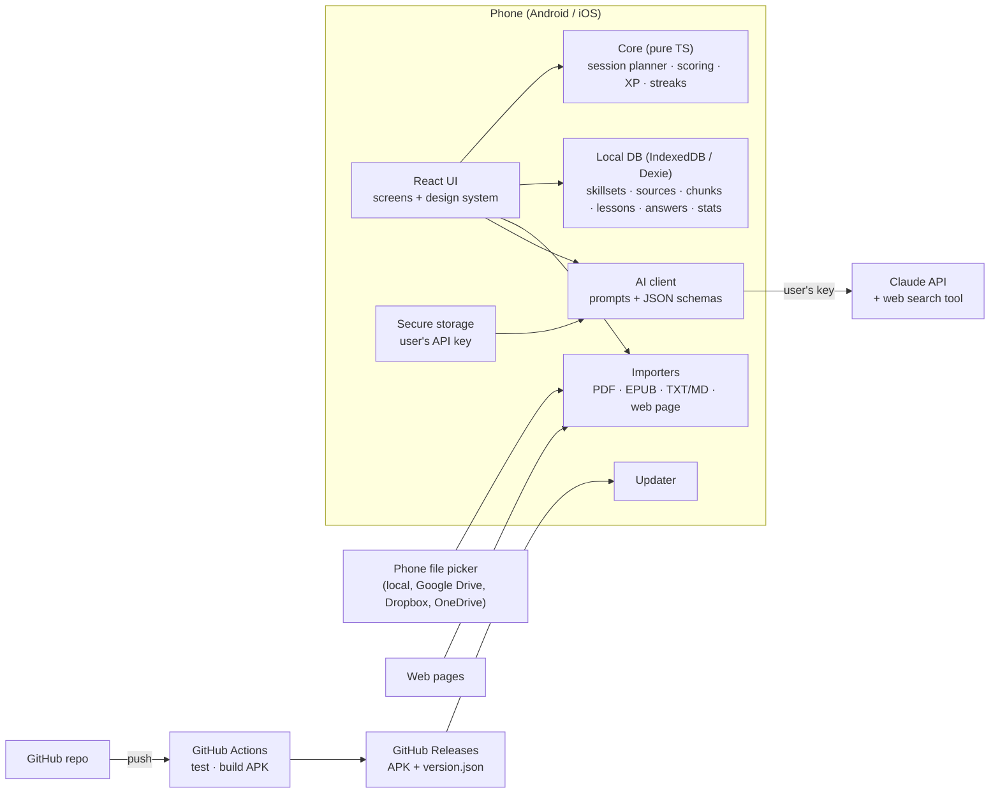

# PES Mobile App — Architecture

**Status:** decided 2026-10-23 — option A (see ADRs)

## 0. "Should it be a web app to avoid version problems?"
**Mostly yes.** Writing the app once in web technology (HTML5 + TypeScript) gives one codebase for Android, iOS and the browser, and lets the app update without waiting for store review. A pure web app alone falls short on three of your requirements, though: no APK or store listing, weak reminders on iPhone, and no secure place for the API key. The usual answer is a **web core inside a thin native shell** (Capacitor): the same web code ships as an APK/iOS app, gets native file access, notifications and secure storage, and can still pull updates from GitHub.

## 1. Options

| | **A. Web core + Capacitor shell** *(recommended)* | **B. Pure web app (PWA)** | **C. Expo / React Native** |
|---|---|---|---|
| What it is | React + TypeScript web app, packaged as Android/iOS apps by Capacitor; also runs in a browser | Same web app, installed from the browser ("Add to home screen") | Native UI written in React Native |
| APK / stores | Yes / Yes | No APK; Play only via a wrapper later; App Store no | Yes / Yes |
| Updates from GitHub | Yes: CI builds the APK into GitHub Releases, app offers the update; later live web-layer updates | Instant: every push to GitHub Pages | Via Expo's update service, not GitHub |
| Files incl. Google Drive / Dropbox | Phone's file picker | Browser file picker | Phone's file picker |
| Reminders on iPhone | Native local notifications | Limited | Native |
| Secure key storage | Keychain / Keystore | Browser storage only | Keychain / Keystore |
| Fit for you as co-developer | HTML/CSS/TS, close to the current hub | Same | React Native specifics, more native tooling |
| Cost for MVP | $0 (GitHub Actions free for public repos) | $0 | $0 with Expo free tier and queues |

### Decision matrix (1–5, weighted)

| Criterion | Weight | A | B | C |
|---|---|---|---|---|
| Updates straight from GitHub | 3 | 4 | 5 | 2 |
| APK now, stores later | 3 | 5 | 1 | 5 |
| Time to MVP | 2 | 4 | 5 | 3 |
| Native features (files, reminders, secure key) | 2 | 4 | 2 | 5 |
| Easy for Oleg + Claude to maintain | 2 | 5 | 5 | 3 |
| Native look and feel | 1 | 3 | 3 | 5 |
| **Weighted total** | | **56** | **45** | **48** |

**Recommendation: A.** It matches all nine points: APK now, store path later, updates from GitHub, one web codebase.

## 2. Recommended architecture (A) in detail



| Layer | Choice | Why |
|---|---|---|
| UI | React 19 + TypeScript + Vite | Mainstream, fast, easy to co-develop |
| Native shell | Capacitor 8 | Same web code → Android/iOS; plugins for files, notifications, secure storage |
| Styling | CSS variables (design tokens) + component CSS | Readable for you; light theme later = one token set |
| Local data | IndexedDB via Dexie; versioned schema; JSON export | Works offline and in the browser |
| Sources | Phone file picker; pdf.js for PDF; EPUB via JSZip; web pages via native HTTP | Covers local files and cloud drives without OAuth setup |
| Lesson engine | Sources → chunks (≈ pages/sections) → curriculum; each session takes the next chunk(s) sized to the minutes chosen | Large books never sent whole; lessons follow the source order |
| AI | Claude Messages API from the device with the user's key; JSON-only responses checked against schemas; web search tool when "use internet" is on; provider interface for others later | No server needed, cost on the user's key |
| Updates (dev) | Push → GitHub Actions builds signed APK → GitHub Release; app checks the latest release and offers install | "Updates directly from my GitHub" |
| Updates (public) | Play Store / App Store; optional live web-layer updates later | Store rules |
| Later (M3) | Supabase (free tier): accounts, leaderboard, sync | Only when needed |

### Build constraint
My workspace can't reach Google's Android build servers, so **APKs are built by GitHub Actions** (free for public repos). That needs the code on GitHub, either pushed by me (if you connect GitHub to Claude) or by you from your Mac.

### Repository
New **public** repo `pes-app` (the app has no secrets thanks to BYOK; a public repo lets the app check for updates without a token). Your existing `Personal-Education-System` repo stays private with your notes. Locally: `Personal Education System/pes-app/` (ignored by the parent repo).

```
pes-app/
  src/
    app/          routing, layout, providers
    screens/      Home, Skillsets, Skillset, Session, Stats, Rewards, Settings, Onboarding
    components/   design-system pieces (Card, Ring, ProgressBar, TabBar, Button…)
    core/         pure logic + tests (planner, scoring, xp, streak, levels, badges)
    ai/           provider client, prompts, response schemas
    data/         Dexie DB, repositories, export/import
    sources/      importers and chunking
    update/       GitHub release checker
  android/        Capacitor Android project
  .github/workflows/android.yml
  docs/           brief, architecture, changelog
  CLAUDE.md       working rules for Claude
```

## 3. Milestones
- **M1 — MVP on your Android phone:** everything in the brief's M1 scope + CI + self-update.
- **M2:** iOS build (your Mac/Xcode), daily reminders, light theme, flashcards with spaced repetition.
- **M3:** accounts, leaderboard, sync across devices (Supabase); direct cloud-folder sync.
- **M4:** store releases (Play, App Store), Russian UI, more AI providers.

## 4. ADRs

### ADR-001 — Web core in a Capacitor shell
- **Context:** one codebase for Android, iOS and browser; updates from GitHub; Oleg co-develops in web tech.
- **Decision:** React 19 + TypeScript + Vite, packaged with Capacitor 8.
- **Consequences:** native features come through Capacitor plugins; UI is custom (no native widgets); iOS build needs Xcode on Oleg's Mac or a cloud builder.

### ADR-002 — Local-first data, no backend in M1
- **Decision:** IndexedDB via Dexie, versioned schema, JSON backup/restore.
- **Consequences:** no accounts, sync or leaderboard until M3 (Supabase planned).

### ADR-003 — Bring-your-own Claude key, calls from the device
- **Decision:** the user's key lives in Android Keystore / iOS Keychain (`@aparajita/capacitor-secure-storage`); the app calls the Messages API directly. Structured output via forced tool calls; internet research via the server-side web search tool. Default model `claude-sonnet-5-5`, user can pick any model from `/v1/models`.
- **Consequences:** no developer secrets anywhere; API cost and rate limits are the user's; a provider interface can add other LLMs later.

### ADR-004 — APKs built by GitHub Actions, self-update from GitHub Releases
- **Context:** Claude's workspace cannot reach Google's Android build servers.
- **Decision:** public repo `helgurkonungson/pes-app`; each push builds and tests; a new `package.json` version publishes Release `vX.Y.Z` with the APK; the app checks `releases/latest` and offers the download — automatically once per local day (first launch or first return to the foreground; result cached in `profile.updateCheck`, a failed check is not recorded) with a pop-up that never opens over a lesson, and on demand in Settings (0.5.1). Release signing key kept in GitHub secrets.
- **Consequences:** every shipped change needs a version bump + CHANGELOG entry; losing the signing key means reinstalling the app (back it up).

### ADR-005 — Lesson engine: sources → chunks → time-sized sessions
- **Decision:** imported text is split into ~1,500-word chunks following the source's structure; a session plan converts minutes into theory words, quiz size and how much source to feed; the cursor moves through chunks in order; review uses the last lesson's key points and recent mistakes.
- **Consequences:** big books are never sent whole; coverage % is measurable; a 15-min portion teaches ≈ 5,000 source words.

### ADR-006 — Lessons without AI (offline engine)
- **Context:** AI may be unavailable: no key, no internet, or the account ran out of credits (Oleg, 2026-10-23). The app must stay useful.
- **Decision:** `src/core/offline.ts` builds lessons on the device from the learner's sources: the next ~(minutes × 0.6 × 180) words are read (cursor = chunk + word offset, stops at paragraph ends), fill-in-the-gap questions are generated from that text (same-script distractors, grammatical endings matched), and the open question is self-checked against key sentences. `aiState()` decides per session: AI when it works; “credits/auth” errors are remembered in the profile (credits retried after 6 h) and the session falls back automatically; network errors let the learner choose. Settings → “Always without AI” never calls the API.
- **Consequences:** quality without AI is lower than AI lessons but free and offline; offline sessions record `readTo` so AI and offline lessons share the same reading cursor.

### ADR-007 — Course files with id-based progress
- **Context:** ready-made lessons (first: Oleg's private CDO test course) must work without AI and be updatable without losing progress.
- **Decision:** a course is a JSON file `format: "pes-course"` (`src/core/course.ts`) imported into table `courses` (Dexie v2). A skillset points to it via `courseId`. The next lesson is the first lesson whose id isn't in the skillset's finished sessions, so a newer version (same course id) can add, reorder or edit lessons and progress stays. Finished sessions keep a copy of the lesson they taught. Review = previous lesson's key points + its `recall` questions + recent mistakes.
- **Consequences:** course content lives outside the public repo (only a tiny English fixture is in `tests/fixtures`). Authoring tools: `validate.py` / `build_course.py` kept with the course, not in the app.

### ADR-008 — Interface language (i18n)
- **Decision:** `src/i18n` — typed keys, English reference dictionary, Russian with all plural forms (Intl.PluralRules); `useT()` in React, `t()` in services. Language = profile preference or the phone's language; cached in localStorage to avoid a flash on start. Dates via Intl.
- **Consequences:** every UI string goes through `t()`; adding a key to `en.ts` without `ru.ts` fails type-check and a unit test.

### ADR-009 — Progress survives updates
- **Context:** “updates must not reset progress of started skillsets”.
- **Decision:** (1) same app id + release key + default WebView origin (guarded by `src/config.test.ts`); (2) schema changes only additive (`this.version(n)`), migration covered by a test with live v1 data; (3) automatic snapshot of the whole DB into the app's private files after each lesson, import and when the app goes to the background; restored automatically if the DB comes up empty; cleared by “Delete all data”; (4) before installing an update the app writes a backup to Documents/PES (survives uninstall) and onboarding offers “Restore from backup”.
- **Consequences:** a few MB written per snapshot (sources included); acceptable on phones.

### ADR-010 — Test strategy and compatibility
- **Decision:** test pyramid in CI — Vitest unit/integration (fake IndexedDB) → Playwright E2E on Chromium (Android WebView engine) and WebKit (iOS engine) device profiles + desktop, with axe accessibility and layout checks → Android emulator smoke tests of the real APK (API 31/34/36, small phone, tablet). Chromium E2E gates the release; WebKit/Firefox and emulator jobs report until stable. Details: `docs/TESTING.md`.

### ADR-011 — Several AI providers
- **Context:** Oleg wants to use ChatGPT, Alice AI and Qwen keys, not only Claude.
- **Decision:** `src/ai/providers.ts` + `src/ai/compat.ts`: Claude keeps the Anthropic Messages API; ChatGPT (api.openai.com), Alice AI (Yandex AI Studio, `llm.api.cloud.yandex.net/v1`, model URI `gpt://<folder>/<model>`, header `OpenAI-Project`) and Qwen (DashScope compatible mode, intl/China) and NVIDIA (`integrate.api.nvidia.com/v1`, added in 0.3.1) use OpenAI-compatible Chat Completions with function calling; Yandex and NVIDIA get `tool_choice: auto` plus a JSON-in-text fallback. On the phone requests go through Capacitor native HTTP (no CORS). One key per provider in secure storage; the old `anthropic_api_key` name is kept.
- **Consequences:** web research stays Claude-only; lesson quality varies by model; provider error texts are mapped to the same kinds (credits/auth/rate…), so the offline fallback works for all.

### ADR-012 — Gemini, Groq and custom OpenAI-compatible servers
- **Decision:** same OpenAI-compatible client. Gemini: `generativelanguage.googleapis.com/v1beta/openai` (Bearer key, tool_choice auto + JSON fallback, ids may come as `models/…`). Groq: `api.groq.com/openai/v1` (forced function). Custom: user-entered base URL (http allowed, key optional, model from `/models` or typed). Readiness = key saved, or for custom: address + model (`providerReady()`). A 400 mentioning tools triggers one retry with `tool_choice: auto` (then without tools). **0.4.2:** transient 5xx (500/502/503/529) are re-sent twice (2 s, 5 s); a request that still fails with 5xx/504 is sent once more without tools, with the JSON schema in the system prompt. Gemini: `reasoning_effort: low` for 2.5+ models (dropped on a 400 that mentions reasoning/thinking) and `max_tokens` + 4096 for thinking; error bodies may be an array `[{error:{code,message,status}}]`. The session error screen shows status + provider message.
- **Consequences:** `android:usesCleartextTraffic="true"` so the app can reach LAN servers over http (only native HTTP; the WebView keeps blocking mixed content). Local models vary a lot in quality and speed — custom requests get a 10-minute timeout.

### ADR-013 — AI lessons written in resumable steps
- **Context:** Gemini (free tier especially) kept failing on the single large "write the whole lesson" request — long thinking, 5xx/504 and per-minute limits — and when the phone fell asleep the request died and the next try started from zero.
- **Decision:** a lesson is generated in small requests: plan (title, section headings + focus + which excerpts, key points, open question) → one request per theory section (only its excerpts) → review → quiz (written from the theory actually produced). After every step the partial result is saved in a `LessonDraft` (Dexie v3, table `drafts`, one per skillset). `prepareSession` reuses a draft with the same portion and the same source chunks (≤ 3 days old) and deletes it when the lesson is saved. A malformed step is re-asked once. Per-minute 429s with a short "retry in Ns" are waited out (≤ 65 s, twice). While writing, the screen is kept on (own `ScreenAwake` plugin: `FLAG_KEEP_SCREEN_ON`; Screen Wake Lock API on the web). If a step fails with a network/5xx error after the app was in the background, the session screen does not show an error: it waits until the app is visible and continues from the draft automatically (up to 3 times).
- **Consequences:** 4 + N requests per lesson instead of 1 (source excerpts are sent to the plan and to their section only) — more input tokens, but each answer is short, so it finishes within provider limits; progress shows "step i of n". Applies to all providers, Claude included. A true background service is not used: when the OS suspends the app, work stops and resumes from the last saved step.

### ADR-014 — Book hygiene: skip front/back matter, clean extracted text
- **Context:** lessons without AI started with the title page, copyright, contents and preface, full of control characters and PDF debris — unreadable.
- **Decision:** `src/core/cleanText.ts`. `cleanSourceText` (idempotent): NFKC, removes control/zero-width/private-use/replacement characters, soft hyphens, dot leaders, page-number and symbol-only lines, joins line-end hyphenation; applied in the chunker on import and again when lessons are built (so existing books benefit and reading offsets stay consistent). `analyzeChunks` per source: content starts at the first "Глава/Chapter/Часть/Part 1" heading in the first half that is followed by prose and is not on a contents page — earlier chunks are skipped and that chunk is trimmed to the heading; without such a heading, chunks near the start that look like imprint (ISBN, ©, УДК/ББК…), contents (short lines ending in page numbers) or carry front-matter headings (предисловие, введение, preface, introduction…) are skipped; near the end: index, bibliography, notes. Near-empty chunks are skipped. A source is never skipped entirely. `lessonChunks()` is used for offline and AI lessons.
- **Consequences:** heuristics — an unusual book may keep some front matter or (rarely) lose an introduction the learner wanted; chunks themselves are not changed in the database, so the behaviour can be tuned later without migrations.

### ADR-015 — Start AI lessons early; finish them in the background
- **Decision:** `generateLesson` writes plan → review → parts → quiz and calls `onPartial` with an assembled partial lesson (`lesson.building = {done, total, sections, error?}`) once the review and part 1 exist. `sessionService.writeAiLesson` saves the session at the first partial and returns it (the screen's cancel only aborts before that point); later partials and the final lesson are written with `db.sessions.update(id, { lesson })` only — the screen writes only progress/status, so neither overwrites the other. Questions are shuffled with fixed seeds so their option order is stable across partials. `lessonPages` ends a building lesson at a `pending` page (cannot advance); the session screen follows the record with Dexie `liveQuery`. Failures after the start set `building.error`; `continueWriting(sessionId)` resumes from the draft (on opening the lesson, on returning to the app, Retry on the pending page, or when `prepareSession` finds such a session). One writer per session (in-memory map; `continueWriting` registers itself before its first await). **0.9:** writers save through `storeWrittenLesson` (a transaction that keeps the stored review and never turns a finished lesson back into a building one), the final lesson is stored before its draft is deleted, and `refreshReview` patches only the review of the freshly read record — a stale copy had overwritten finished lessons, which then lost their draft and were dropped.
- **Consequences:** the learner usually waits only for plan + review + part 1. If the app is killed, writing resumes next time the lesson is opened.

### ADR-016 — Placement test first, for every kind of material
- **Decision:** `needsPlacement(skillset)` (core/scoring): no placement result and not skipped — or skipped by an older version while no lesson is done. Tests: AI (`generatePlacement`, numbered excerpts, each question's `excerpt` → `Mcq.ref` = chunk id), offline (`buildOfflinePlacement`: one gap question per sampled chunk, `ref` = chunk id; null when < 3 questions → start from zero), course (`buildCoursePlacement`: hardest quiz question of up to N lessons spread over the course, `ref` = lesson id). If the AI can't write the test (no credits/key), the offline test is used. `scorePlacement` adds `known` = refs whose every question was right. `skipPlacement` stores `skippedPlacement()` (beginner, nothing known, `skipped: true`) and removes an unfinished test. Lessons: `lessonChunks(chunks, placement.known)` (offline + AI) and `coveredLessonIds(done, known)` for the next course lesson; AI prompts get "ALREADY KNOWN … don't re-teach" from strengths and "assume no prior knowledge" when skipped. First lesson (no finished lesson yet): AI skips the review step, offline/course lessons have no review.
- **Consequences:** a learner who gets material right never sees it in lessons (they can still read sources); with few chunks the offline test may be impossible → start from zero.

### ADR-017 — Spaced repetition, intermediate tests and the final test instead of an AI review
- **Decision:** every answered question becomes a Leitner card (`src/core/srs.ts`, Dexie v4 table `cards`, index `[skillsetId+due]`): boxes 0–6, intervals 1/3/7/14/30/60 days, a wrong answer sends it back to box 0. The review step is built by the app (`sessionService.buildReview`), never by the AI: cards due today (≤ 6) plus the last lesson's key points; every 5th lesson (`CHECKPOINT_EVERY`, ≥ 4 cards) it is an **intermediate test** of 8 cards picked round-robin by topic, weakest first (`lesson.checkpoint`, result `checkpoint {correct,total}`); when all material is covered (sources read to the end, or the last course lesson done) a **final test** session (`kind: "final"`, 15 cards, `skillset.final`) comes before "finished". A ready lesson gets its review refreshed when it is started on a later day. Placement uses 2 questions per part; a part counts as known only if both are right ("I don't know" = wrong). Without AI the open question is left out (`lessonPages(l, {open:false})`) — nothing could grade it.
- **Consequences:** one fewer AI request per lesson; reviews work identically with and without AI. Old lessons keep their stored review.

### ADR-018 — Reminders, listening, error journal, token usage
- **Decision:** reminders with `@capacitor/local-notifications` (inexact alarms, `SCHEDULE_EXACT_ALARM` removed from the manifest): 7 days of daily reminders at the chosen time (with due-card count) + a 21:30 "streak at risk" nudge, re-planned on start/resume/after a lesson (`core/reminders.ts` pure, `native/reminders.ts`); offered once after the first lesson. Listening: `@capacitor-community/text-to-speech` (phone's own engine, offline) / Web Speech API; Markdown stripped, spoken in sentence pieces ≤ 1500 chars. Error journal: Dexie table `logs` (last 200), window errors, unhandled rejections, AI and import errors; secrets masked by pattern before writing; sent only by the learner through the share sheet. Token usage: Anthropic `usage` / OpenAI-compatible `usage` per request → `lesson.usage` and `profile.usage[YYYY-MM]`.

### ADR-019 — Automatic offline OCR for scanned PDFs
- **Decision:** PDF pages whose text layer has < 25 letters are rendered with pdf.js (~2000 px long side) and recognised with tesseract.js 7 (LSTM only) and the Russian + English `best_int` models. The engine ships inside the APK (`tools/ocr-assets.mjs` copies worker, SIMD/non-SIMD cores and models into `public/ocr` at every Vite start; gitignored) — no CDN, no network, pages never leave the phone; loaded lazily only when a scan is found. The learner does nothing extra: progress "Recognising text on page i of n", a toast with the number of recognised pages.
- **Consequences:** APK +~13 MB; recognition takes a few seconds per page on a phone; quality depends on the scan.

### ADR-020 — Every CI gate blocks the release; bilingual release notes
- **Decision:** the `release` job runs after `build`, `e2e-cross` (WebKit, Firefox) and `device-tests` (emulators) all pass; nothing is `continue-on-error` any more. Emulator smoke: system error dialogs hidden, the (unused) Pixel Launcher disabled for the run — API 34 images kept raising "Pixel Launcher isn't responding" over the app — a render retry, and one full retry of the script. Release notes: `tools/release-notes.mjs` writes `<!--lang:ru-->` (CHANGELOG.ru.md) and `<!--lang:en-->` (CHANGELOG.md) sections; the update pop-up shows the section of the UI language (`notesForLang`).
- **Consequences:** a red emulator run now delays the APK; re-run the job if an emulator image misbehaves.
